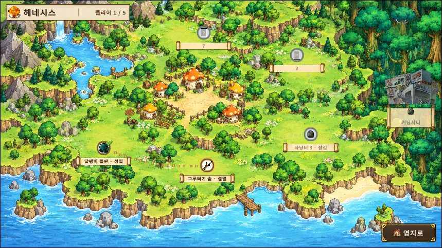

# 유정재 포트폴리오

**게임 기획 · C++ 게임 서버**

QA 2년 · C++ 서버 1년 · 메이플스토리 월드 게임 기획 · 출시

 

| 분야 | 프로젝트 | 한 줄 소개 | 자료 |
|:---:|---|---|---|
| 🎮 기획 | [**메이플 빌리지**](planning-maple-village) | 메이플스토리 월드 SRPG · 1인 개발 · 2026.10.31 출시 | [플레이](https://maplestoryworlds.nexon.com/ko/play/d881daaedf5d484f994357db0f8c6438) · [기획서 PDF](planning-maple-village/maple-village-planning.pdf) |
| 🖥 서버 | [**IOCP 채팅 서버**](server-iocp-chat) | Windows IOCP 멀티스레드 서버 · 1,000 동접 2시간 검증 | [코드](https://github.com/yjj2123/iocp-chatserver) |
| 🖥 서버 | [**TCP Fighter**](server-tcp-fighter) | select 기반 2D 액션 MMO 서버 · 2만 세션 접속 | [코드](https://github.com/yjj2123/tcpfighter-select-mmo) |

 

## 경력 · 교육

| 기간 | 내용 |
|---|---|
| 2023.03 ~ 2025.03 | **EA Korea · QA** — FC 온라인 리브랜딩 프로젝트 |
| 2025.04 ~ 2026.04 | **프로카데미** — C++ 게임 서버 프로그래밍 |
