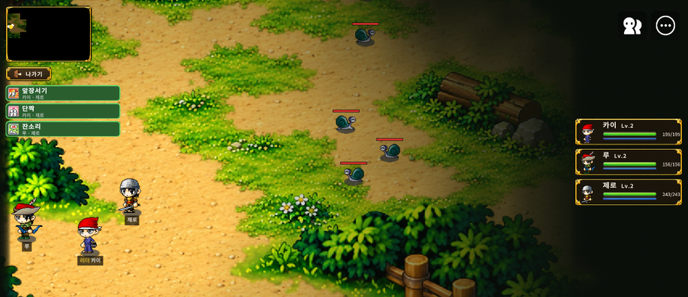
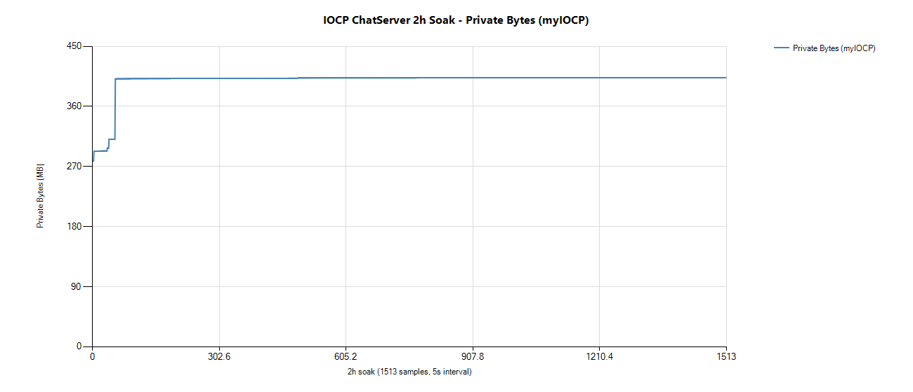

# 유정재

**게임 기획 · C++ 게임 서버**

QA 2년 · C++ 서버 1년 · 메이플스토리 월드 게임 기획 · 출시

 

## 🎮 기획

### 메이플 빌리지

성격이 제각각인 주민을 데리고 영지를 꾸리고 바깥을 원정하는 실시간 쿼터뷰 RPG

| | |
|---|---|
| 기간 | 2026.06 ~ 운영 중 · **2026.10.31 공개 출시** |
| 역할 | 1인 개발 — 기획 · 수치 · QA · 운영 (문서 정리 · 구현은 AI 세션 활용) |
| 도구 | MapleStory Worlds Maker · Claude · Codex |

- **시스템 기획서 24개 장** — 장마다 구현 · QA 가 그대로 판정할 수 있는 '확인 기준' 절
- **측정으로 맞춘 밸런스** — 성장 기간 약 15일 → 21일, 첫 사냥터 클리어 15/20 → 18/20
- **출시 후 6번 업데이트** — v1.0.0 → v1.1.3 (침공 · 훈련소 · 공방 · 새 마을 · 채팅 추가)

 

## 🖥 서버

### IOCP 채팅 서버

Windows IOCP 기반 멀티스레드 채팅 서버 · 개인 프로젝트 (2026.04 ~ 06)

`C++17` `IOCP` `Lock-Free` `MSSQL` `AES-CTR + HMAC`

- **락 없는 컨텐츠 처리** — 컨텐츠 전담 스레드 하나, DB 호출은 별도 스레드
- **Lock-Free 메모리 풀 · 패킷 암호화** — ABA 방지, AES-128-CTR + HMAC-SHA256
- **2시간 부하 검증** — 동접 약 1,000 · 접속/해제 51만 회, 메모리 변동 0.4% · 에러 0건

### TCP Fighter

select 기반 2D 액션 MMO 서버 · 학원 과제 (2026.01 ~ 03)

`C++` `Winsock2 select` `섹터 AOI`

- **2만 세션 접속** 확인 (목표 15,000)
- **625개 섹터 AOI** — 주변 9칸에만 전송
- **서버 권위 좌표 검증** — 클라이언트 위치 조작 차단

 

## 💼 경력 · 교육

| 기간 | 내용 |
|---|---|
| 2023.03 ~ 2025.03 | **EA Korea · QA** — FC 온라인 리브랜딩 프로젝트 |
| 2025.04 ~ 2026.04 | **프로카데미** — C++ 게임 서버 프로그래밍 |
