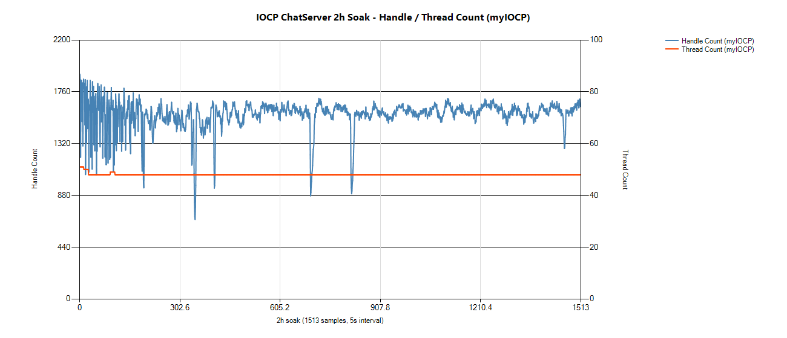

# 유정재 포트폴리오

> 게임 기획 · C++ 게임 서버. QA 2년, C++ 서버 공부 1년, 메이플스토리 월드 게임 **메이플 빌리지** 기획 · 출시.

| | 프로젝트 | 분야 | 링크 |
|---|---|---|---|
| 1 | [메이플 빌리지](#1-메이플-빌리지) | 기획 · 1인 개발 · 출시 | [플레이](https://maplestoryworlds.nexon.com/ko/play/d881daaedf5d484f994357db0f8c6438) · [기획 포트폴리오 PDF](assets/maple-village-portfolio.pdf) |
| 2 | [IOCP 채팅 서버](#2-iocp-채팅-서버) | C++ 서버 · 개인 | [코드](https://github.com/yjj2123/iocp-chatserver) |
| 3 | [TCP Fighter](#3-tcp-fighter) | C++ 서버 · 학원 과제 | [코드](https://github.com/yjj2123/tcpfighter-select-mmo) |

---

## 1. 메이플 빌리지

> 성격이 제각각인 주민을 데리고 영지를 꾸리고 원정하는 메이플스토리 월드 SRPG. 2026.10.31 공개 출시.

- **역할** — 규칙 · 수치 · 출시 결정 · 플레이 확인은 직접, 문서 정리 · 구현 · 테스트는 역할을 나눈 AI 세션에 맡김
- **기획서 24개 장** — 장마다 '확인 기준' 절. 명령 무시 확률 30% → 1,000회 중 257 ~ 343회면 정상(±3σ)
- **밸런스** — ★1 주민 Lv10 도달 약 15일 → 약 21일로 조정 / 첫 사냥터 자동 20판 중 15판 → 18판 클리어로 조정
- **출시 후 6번 업데이트** — v1.0.0 → v1.1.3. v1.1.0 에서 침공 · 훈련소 · 공방 · 새 마을 · 채팅 추가
- **AI 교차 검증** — 버그는 다른 세션이 확인한 것만 개발로 넘김. 212건 중 37건을 잘못된 판정으로 걸러 냄

📄 상세 → [기획 포트폴리오 PDF (33쪽)](assets/maple-village-portfolio.pdf)

---

## 2. IOCP 채팅 서버

> Windows IOCP 기반 멀티스레드 채팅 서버. 혼자 설계 · 구현 (2026.04 ~ 06).

- **구조** — IOCP 워커는 패킷을 큐에 넣고, Update 스레드 하나가 컨텐츠를 전담해 컨텐츠 영역의 락을 없앰
- **DB 비동기** — MSSQL 호출을 별도 DB 스레드로 넘겨 채팅이 멈추지 않게 함
- **Lock-Free 메모리 풀** — 17bit 스탬프로 ABA 문제 방지
- **암호화** — AES-128-CTR + HMAC-SHA256. 변조 패킷은 복호화 전에 버림
- **버그 19건** — 멀티스레드 자원 반환 문제를 증상 → 원인 → 해결로 기록 ([BUGFIX_LOG](https://github.com/yjj2123/iocp-chatserver/blob/main/BUGFIX_LOG.md))
- **2시간 부하 검증** — 동접 약 1,000, 접속 · 해제 51만 회. 메모리 변동 0.4%, 에러 0건

 

💻 코드 · 상세 → [github.com/yjj2123/iocp-chatserver](https://github.com/yjj2123/iocp-chatserver)

---

## 3. TCP Fighter

> select 기반 2D 액션 MMO 서버. 서버 전체 직접 구현 (2026.01 ~ 03).

- **2만 세션 접속** — 학원 환경, 목표 15,000
- **625개 섹터 AOI** — 주변 9칸에만 전송해 전송량 절감
- **서버 권위 좌표** — 클라이언트 좌표가 50px 이상 다르면 서버 좌표로 동기화
- **select 한계 측정** — 세션이 늘 때 Loop/sec 125,539 → 8,142. IOCP 로 옮긴 근거

💻 코드 · 상세 → [github.com/yjj2123/tcpfighter-select-mmo](https://github.com/yjj2123/tcpfighter-select-mmo)

---

## 경력 · 교육

| 기간 | 내용 |
|---|---|
| 2023.03 ~ 2025.03 | **EA Korea · QA** — FC 온라인 리브랜딩. 출시 후 라이브 이슈 수가 사내 유사 규모 프로젝트 대비 약 10% 미만 |
| 2025.04 ~ 2026.04 | **프로카데미** · C++ 게임 서버 프로그래밍 |
