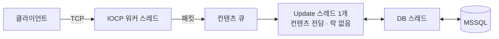

# 유정재

### 기획서를 쓰고, 서버를 이해하고, AI와 함께 게임을 출시했습니다

 

- **QA 2년** — EA Korea 에서 FC 온라인 리브랜딩 QA. 명세와 실제 동작의 차이를 검증했습니다
- **C++ 서버 1년** — IOCP 채팅 서버를 혼자 만들고 1,000 동접 · 2시간 부하로 검증했습니다
- **기획 · 출시** — AI 세션들과 역할을 나눠 메이플스토리 월드 게임 **메이플 빌리지**를 기획부터 출시 · 운영까지 했습니다

 

| 출시 후 업데이트 | 시스템 기획서 | 서버 부하 검증 | AI 교차 검증 |
|:---:|:---:|:---:|:---:|
| **6회** v1.0.0 → v1.1.3 | **24개 장** 장마다 확인 기준 | **에러 0건** 1,000 동접 · 2시간 | **37건** AI 가 잘못 판정한 버그를 다른 세션이 걸러 냄 (212건 중) |

 

---

## 🎮 메이플 빌리지 &nbsp;기획 · 1인 개발 · 2026.10.31 출시

**[▶ 게임 플레이](https://maplestoryworlds.nexon.com/ko/play/d881daaedf5d484f994357db0f8c6438)** &nbsp;·&nbsp; **[📄 기획서 PDF](planning-maple-village/maple-village-planning.pdf)** &nbsp;·&nbsp; **[쪽 안내 · 스크린샷](planning-maple-village)**

성격이 제각각인 주민을 데리고 영지를 꾸리고 원정하는 실시간 쿼터뷰 RPG. 규칙과 수치는 직접 정하고, 문서 정리 · 구현 · 테스트는 AI 세션에 나눠 맡겼습니다.

- **확인 기준까지 쓴 기획서** — "명령 무시 30%" 라면 1,000회 중 257 ~ 343회일 때 정상. 구현과 QA 가 같은 기준으로 판정합니다
- **플레이해 보고 고친 수치** — ★1 주민 Lv10 도달이 출시 당일 약 15일로 빨라 약 21일로 늘렸습니다
- **출시 후 운영** — 출시 당일 가격 · 경험치 수정, 일주일 뒤 침공 · 훈련소 · 공방 · 새 마을 · 채팅 추가

> 📖 기획서는 **2 ~ 4쪽** (한 장 요약 · 전체 흐름) 부터 보시면 됩니다

 

---

## 🖥 IOCP 채팅 서버 &nbsp;C++17 · 개인 프로젝트 · 2026.04 ~ 06

**[💻 코드](https://github.com/yjj2123/iocp-chatserver)** &nbsp;·&nbsp; **[📈 부하 검증 그래프](server-iocp-chat)**

- **컨텐츠는 스레드 하나가 전담** — 컨텐츠 영역의 락을 없애고, DB 호출은 별도 스레드로 넘겨 채팅이 멈추지 않게 했습니다
- **멀티스레드 버그 19건** — 세션 · 패킷 반환 시점 문제를 증상 → 원인 → 해결로 기록했습니다 ([BUGFIX_LOG](https://github.com/yjj2123/iocp-chatserver/blob/main/BUGFIX_LOG.md))
- **2시간 부하 검증** — 접속 · 해제 51만 회, 메모리 변동 0.4%, 에러 0건

 

---

## 🖥 TCP Fighter &nbsp;C++ · select 기반 2D 액션 MMO 서버 · 2026.01 ~ 03

**[💻 코드](https://github.com/yjj2123/tcpfighter-select-mmo)**

- **2만 세션 접속** — 맵을 625개 섹터로 나눠 주변 9칸에만 전송
- **서버 권위 좌표** — 클라이언트 좌표가 50px 이상 어긋나면 서버 좌표로 맞춰 위치 조작을 막았습니다
- **select 한계 측정** — 세션이 늘자 Loop/sec 125,539 → 8,142. 이 측정으로 IOCP 로 넘어갔습니다

 

---

## 🤖 AI 와 일하는 방식

1. **역할 나누기** — 세션마다 맡을 일을 지시 파일로 정합니다
2. **문서로 넘기기** — 기획서 한 장 단위로 넘기고, 빈 곳이 있으면 자동 검사가 개발을 막습니다
3. **작게 만들기** — 확인할 수 있는 동작 하나씩 만듭니다
4. **다른 세션이 검증** — 만든 세션이 채점하지 않고, 통과 표시가 없으면 커밋이 막힙니다
5. **기록 남기기** — 끝날 때 이어 할 일을 남겨 다음 세션이 바로 이어 갑니다

 

---

**경력** &nbsp; EA Korea · QA (2023.03 ~ 2025.03) — FC 온라인 리브랜딩 · 출시 후 라이브 이슈가 사내 유사 규모 프로젝트 대비 약 10% 미만 
**교육** &nbsp; 프로카데미 · C++ 게임 서버 프로그래밍 (2025.04 ~ 2026.04)
