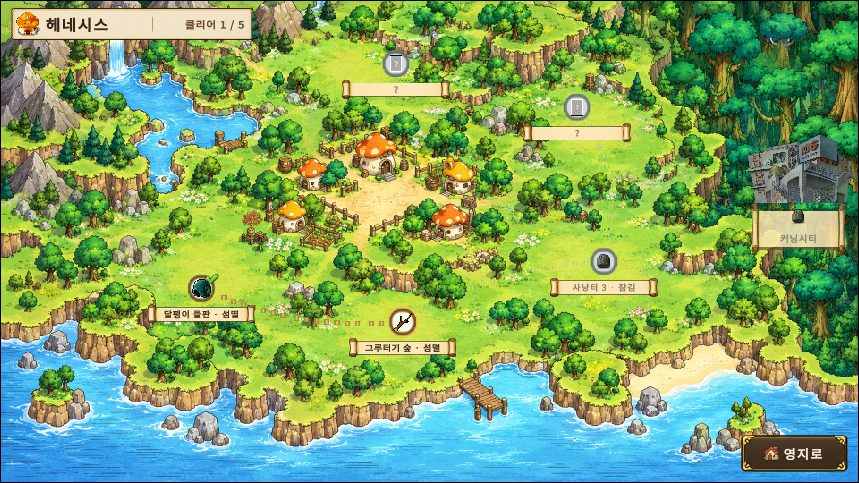
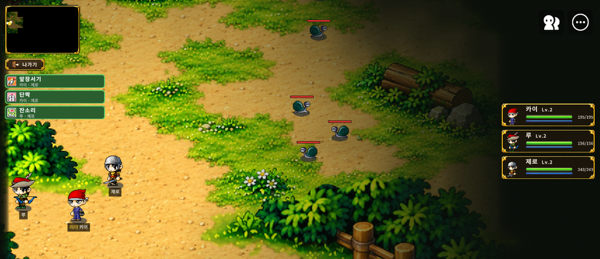

# 🎮 메이플 빌리지

> 성격이 제각각인 주민을 데리고 영지를 꾸리고 바깥을 원정하는 실시간 쿼터뷰 RPG

| | |
|---|---|
| 기간 | 2026.06 ~ 운영 중 · **2026.10.31 공개 출시** |
| 역할 | 1인 개발 — 기획 · 수치 · QA · 운영 (문서 정리 · 구현은 AI 세션 활용) |
| 도구 | MapleStory Worlds Maker · Claude · Codex |

## 핵심

- **시스템 기획서 24개 장** — 장마다 구현 · QA 가 그대로 판정할 수 있는 '확인 기준' 절
- **측정으로 맞춘 밸런스** — 성장 기간 약 15일 → 21일, 첫 사냥터 클리어 15/20 → 18/20
- **출시 후 6번 업데이트** — v1.0.0 → v1.1.3 (침공 · 훈련소 · 공방 · 새 마을 · 채팅 추가)

## 스크린샷

 

## 기획서 PDF 쪽 안내

[maple-village-planning.pdf](maple-village-planning.pdf) (33쪽) — 시간이 없으시면 **2 ~ 4쪽**만 보셔도 게임 전체가 잡힙니다.

| 쪽 | 장 | 볼 내용 |
|:---:|---|---|
| **2 ~ 4** | 요약 · 전체 흐름 | 한 장 요약, 한 판 15 ~ 20분 흐름, 시스템 순환 구조 |
| 5 ~ 12 | 성격 시스템 | 부정적 기질의 손익 계산, 행동 확률, 시너지 |
| 13 ~ 15 | 성격 · 개발 명세 | 서버 판정, 데이터 한 줄 구조, 숫자로 쓴 확인 기준 |
| 16 ~ 22 | 원정 | 직접 · 자동 원정 보상 차이, 전멸 비용, 끊김 시 정산 한 번 |
| 23 ~ 28 | 민심 | 원정 거부 조건, 원인 표시 UI, 서버 계산 |
| 29 ~ 32 | 성장 · 밸런스 | ★1 주민 Lv10 약 21일 기준 경험치 · 식량 계산 |
| 33 | 결과 · 회고 | 출시와 운영 |

[← 처음으로](..)
