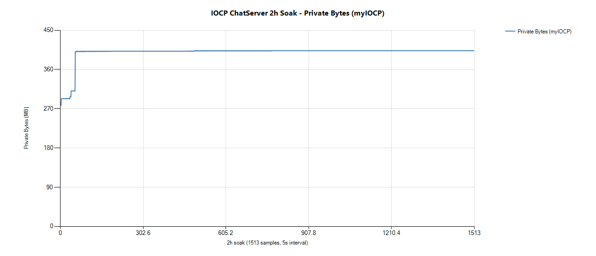
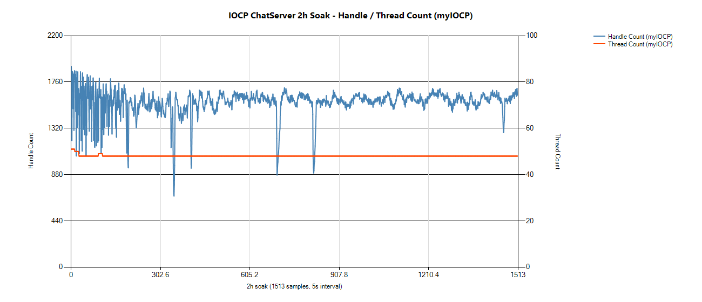

# 🖥 IOCP 채팅 서버

> Windows IOCP 기반 멀티스레드 채팅 서버 · 개인 프로젝트 (2026.04 ~ 06)

`C++17` `IOCP` `Lock-Free` `MSSQL` `AES-128-CTR + HMAC-SHA256`

## 핵심

- **락 없는 컨텐츠 처리** — 컨텐츠 전담 스레드 하나, DB 호출은 별도 스레드
- **Lock-Free 메모리 풀** — 17bit 스탬프로 ABA 문제 방지
- **패킷 암호화** — 변조 패킷은 복호화 전에 버림
- **멀티스레드 버그 19건 기록** — [BUGFIX_LOG](https://github.com/yjj2123/iocp-chatserver/blob/main/BUGFIX_LOG.md)

## 2시간 부하 검증

동접 약 1,000 · 접속/해제 51만 회

| 측정 | 결과 |
|---|---|
| 메모리 (Private Bytes) | 401.4 ~ 403.1MB, 변동 0.4% |
| 핸들 · 스레드 | 우상향 없음 |
| 에러 | 0건 |

 

[← 처음으로](..)
